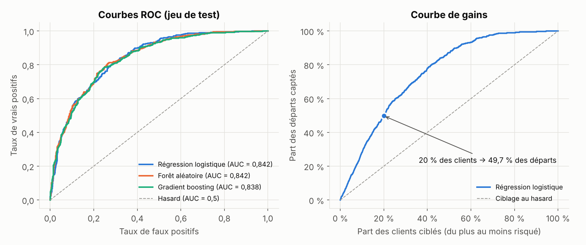
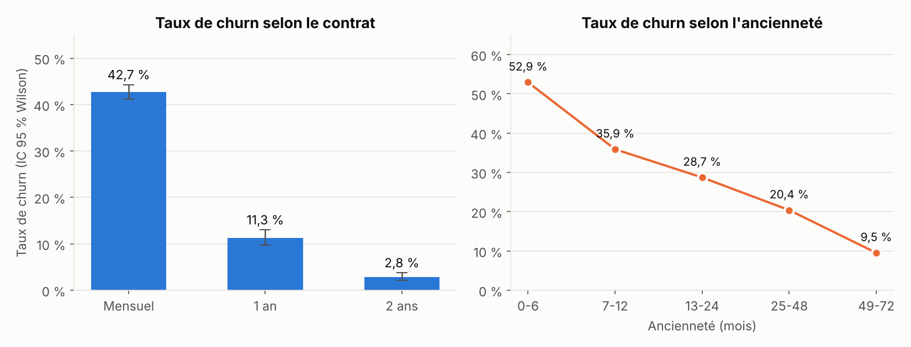
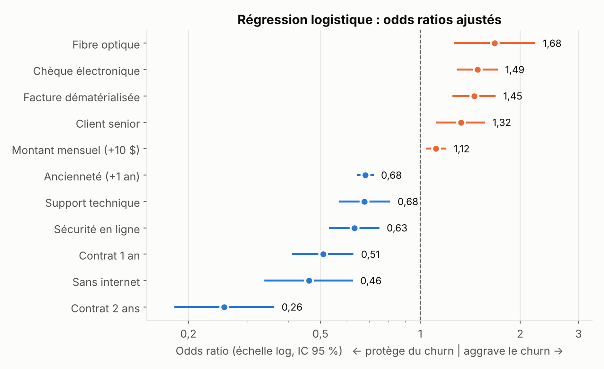
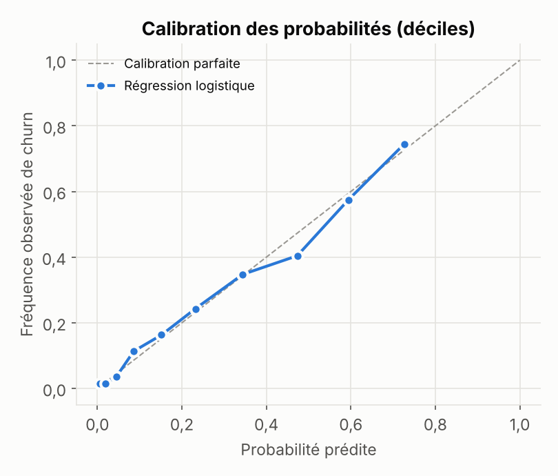

# RetentIA — Prédire et expliquer le churn client dans les télécoms


> **Question métier** : quels clients vont résilier leur abonnement, et **pourquoi** ?
> **Réponse** : le type de contrat et l'ancienneté expliquent l'essentiel du risque. Un modèle simple et interprétable permet de capter **la moitié des départs en ne ciblant que 20 % des clients**.

<p align="center">
  <a href="#1-résumé-exécutif"></a>
  <a href="analysis/churn_analysis.py"></a>
  <a href="#9-reproduire-lanalyse"></a>
</p>

<p align="center"></p>

Projet réalisé dans le cadre du Master Big Data & IA (**ESTIAM Lyon**). Le pipeline a été construit en groupe sous **Dataiku DSS** (Flow complet, de la donnée brute au modèle déployé, plus un dashboard). Ce dépôt contient en complément une **reproduction Python entièrement scriptée**, qui détaille la démarche statistique et rend chaque chiffre vérifiable.

---

## Sommaire

1. [Résumé exécutif](#1-résumé-exécutif)
2. [Données et qualité](#2-données-et-qualité)
3. [Analyse exploratoire et tests statistiques](#3-analyse-exploratoire-et-tests-statistiques)
4. [Modèle explicatif : régression logistique](#4-modèle-explicatif--régression-logistique)
5. [Modèles prédictifs : comparaison rigoureuse](#5-modèles-prédictifs--comparaison-rigoureuse)
6. [Utilité métier : courbe de gains](#6-utilité-métier--courbe-de-gains)
7. [Recommandations](#7-recommandations)
8. [Limites et précautions](#8-limites-et-précautions)
9. [Reproduire l'analyse](#9-reproduire-lanalyse)

---

## 1. Résumé exécutif

| Indicateur | Valeur |
|---|---|
| Clients analysés | **7 043** |
| Taux de churn global | **26,5 %** (IC 95 % Wilson : [25,5 % ; 27,6 %]) |
| Facteur le plus lié au churn | **Type de contrat** (V de Cramér = 0,41) |
| Meilleur modèle (validation croisée 5 plis) | Régression logistique, **ROC-AUC = 0,846 ± 0,013** |
| Gain opérationnel | Cibler **20 %** des clients capte **≈ 50 %** des départs (lift ≈ 2,5) |

**Trois enseignements clés**

1. **Le contrat mensuel est le principal risque** : 42,7 % de départs, contre 2,8 % pour un engagement de 2 ans.
2. **Le risque est concentré sur les premiers mois** : 52,9 % de départs avant 6 mois d'ancienneté, 9,5 % au-delà de 4 ans.
3. **La complexité n'apporte rien ici** : les modèles d'ensemble ne battent pas la régression logistique. On garde le modèle le plus simple, le plus stable et le plus explicable.

---

## 2. Données et qualité

**Source** : jeu public *Telco Customer Churn* (IBM). Une ligne par client, 21 variables :

- **profil** : genre, senior, partenaire, personnes à charge ;
- **services** : téléphone, internet (DSL, fibre), sécurité, sauvegarde, support, streaming ;
- **contrat et facturation** : type de contrat, facture dématérialisée, mode de paiement, montant mensuel, total facturé ;
- **ancienneté** (`tenure`, en mois) et **cible** `Churn` (oui / non).

**Contrôles de qualité effectués**

| Contrôle | Résultat | Traitement |
|---|---|---|
| Doublons sur l'identifiant client | 0 | — |
| `TotalCharges` stocké en texte | 11 valeurs vides | Conversion numérique |
| Origine des 11 valeurs vides | **Toutes** ont une ancienneté de 0 mois | Clients pas encore facturés, donc imputation logique à **0** (et non par la moyenne) |
| Déséquilibre de la cible | 26,5 % de positifs | Échantillonnage **stratifié** et métriques adaptées (PR-AUC) |

> 💡 L'imputation n'est pas faite « par défaut » : l'analyse de la cause montre que la valeur manquante a un **sens métier** (aucune facture émise). La valeur exacte est donc 0.

---

## 3. Analyse exploratoire et tests statistiques

### 3.1 Méthode

Pour chaque variable, on teste l'hypothèse nulle $H_0$ : *« la variable et le churn sont indépendants »*.

- **Variables qualitatives** : test du $\chi^2$ d'indépendance. Comme $p$ devient minuscule dès que $n$ est grand, on mesure aussi **l'intensité** de la liaison par le **V de Cramér** :

$$V = \sqrt{\frac{\chi^2}{n\,(\min(r,k)-1)}} \in [0,1]$$

- **Taux de churn par modalité** : intervalle de confiance de **Wilson**, plus fiable que l'intervalle de Wald pour les proportions proches de 0 (par exemple 2,8 %) :

$$\frac{\hat p + \frac{z^2}{2n} \pm z\sqrt{\frac{\hat p(1-\hat p)}{n} + \frac{z^2}{4n^2}}}{1 + \frac{z^2}{n}}$$

- **Variables quantitatives** : test de **Mann-Whitney**. Il est non paramétrique, car les distributions ne sont pas normales. La taille d'effet est mesurée par la **corrélation rang-bisériale** $r = 1 - \frac{2U}{n_1 n_2}$.

### 3.2 Classement des variables qualitatives par intensité de liaison

| Variable | $\chi^2$ | ddl | $p$ | **V de Cramér** | Lecture |
|---|---:|---:|---:|---:|---|
| Contrat | 1 184,6 | 2 | $6 \times 10^{-258}$ | **0,41** | Liaison forte |
| Sécurité en ligne | 850,0 | 2 | $3 \times 10^{-185}$ | **0,35** | Forte |
| Support technique | 828,2 | 2 | $1 \times 10^{-180}$ | **0,34** | Forte |
| Type d'internet | 732,3 | 2 | $1 \times 10^{-159}$ | **0,32** | Forte |
| Mode de paiement | 648,1 | 3 | $4 \times 10^{-140}$ | **0,30** | Forte |
| Facture dématérialisée | 259,2 | 1 | $3 \times 10^{-58}$ | 0,19 | Modérée |
| Senior | 160,4 | 1 | $1 \times 10^{-36}$ | 0,15 | Modérée |
| Lignes multiples | 11,3 | 2 | 0,004 | 0,04 | Négligeable |
| Service téléphonique | 1,0 | 1 | 0,32 | 0,01 | **Non significatif** |
| Genre | 0,5 | 1 | 0,47 | 0,01 | **Non significatif** |

> 💡 Le **genre** n'a aucun effet mesurable : on ne rejette pas $H_0$. Le retenir dans un modèle n'apporterait que du bruit, voire un biais.

### 3.3 Le contrat : la variable décisive

| Contrat | Clients | Taux de churn | IC 95 % (Wilson) |
|---|---:|---:|---|
| Mensuel | 3 875 | **42,7 %** | [41,2 % ; 44,3 %] |
| 1 an | 1 473 | 11,3 % | [9,8 % ; 13,0 %] |
| 2 ans | 1 695 | **2,8 %** | [2,1 % ; 3,7 %] |

Les intervalles ne se chevauchent pas : les différences sont **robustes**, pas un effet d'échantillonnage.

### 3.4 L'ancienneté : un risque concentré au début

| Ancienneté (mois) | Clients | Taux de churn |
|---|---:|---:|
| 0 – 6 | 1 481 | **52,9 %** |
| 7 – 12 | 705 | 35,9 % |
| 13 – 24 | 1 024 | 28,7 % |
| 25 – 48 | 1 594 | 20,4 % |
| 49 – 72 | 2 239 | **9,5 %** |



### 3.5 Variables quantitatives

| Variable | Médiane (partis) | Médiane (restés) | $p$ (Mann-Whitney) | Taille d'effet $\lvert r \rvert$ |
|---|---:|---:|---:|---:|
| Ancienneté (mois) | 10 | 38 | $2 \times 10^{-208}$ | **0,48** (forte) |
| Total facturé (\$) | 703,55 | 1 679,53 | $6 \times 10^{-83}$ | 0,30 |
| Montant mensuel (\$) | 79,65 | 64,43 | $3 \times 10^{-54}$ | 0,24 |

---

## 4. Modèle explicatif : régression logistique

Les tests univariés ne suffisent pas : les variables sont **liées entre elles**. Par exemple, les clients fibre paient plus cher et ont plus souvent un contrat mensuel. Une régression logistique isole l'effet de chaque facteur **toutes choses égales par ailleurs** :

$$\log\frac{P(\text{churn})}{1-P(\text{churn})} = \beta_0 + \sum_j \beta_j x_j \qquad \text{et} \qquad \text{OR}_j = e^{\beta_j}$$

Un **odds ratio** (OR) inférieur à 1 protège du churn ; supérieur à 1, il l'aggrave. `TotalCharges` est volontairement exclu, car il vaut à peu près ancienneté × montant mensuel : le garder créerait de la **multicolinéarité** et rendrait les coefficients instables.

| Facteur | Odds ratio | IC 95 % | $p$ |
|---|---:|---|---:|
| Contrat 2 ans (vs mensuel) | **0,26** | [0,18 ; 0,36] | $4 \times 10^{-15}$ |
| Contrat 1 an (vs mensuel) | **0,51** | [0,41 ; 0,63] | $1 \times 10^{-10}$ |
| Ancienneté (par année) | **0,68** | [0,65 ; 0,72] | $1 \times 10^{-50}$ |
| Pas d'internet (vs DSL) | 0,46 | [0,34 ; 0,62] | $4 \times 10^{-7}$ |
| Sécurité en ligne | 0,63 | [0,53 ; 0,75] | $8 \times 10^{-8}$ |
| Support technique | 0,68 | [0,57 ; 0,81] | $1 \times 10^{-5}$ |
| Fibre optique (vs DSL) | **1,68** | [1,27 ; 2,21] | $2 \times 10^{-4}$ |
| Paiement par chèque électronique | **1,49** | [1,30 ; 1,70] | $7 \times 10^{-9}$ |
| Facture dématérialisée | 1,45 | [1,26 ; 1,68] | $4 \times 10^{-7}$ |
| Client senior | 1,32 | [1,13 ; 1,56] | $7 \times 10^{-4}$ |
| Montant mensuel (par tranche de 10 \$) | 1,12 | [1,05 ; 1,19] | $9 \times 10^{-4}$ |



*Pseudo-R² de McFadden = 0,27*. Une valeur entre 0,2 et 0,4 indique un très bon ajustement pour un modèle logistique.

**Lecture**

- À profil égal, un client en **contrat 2 ans** a une cote de churn **environ 4 fois plus faible** qu'un client en contrat mensuel ($1/0{,}26 \approx 3{,}9$).
- **Chaque année d'ancienneté** réduit la cote de churn de **32 %**.
- La **fibre** reste un facteur de risque **même à prix égal** (OR = 1,68). Ce n'est donc pas qu'une question de tarif : la qualité du service ou la concurrence sur la fibre sont des pistes à creuser.
- Les **services d'accompagnement** (sécurité, support) sont associés à une cote de churn réduite d'environ un tiers (OR ≈ 0,63 à 0,68).

---

## 5. Modèles prédictifs : comparaison rigoureuse

**Protocole**

- Un jeu de **test** de 20 % (1 409 clients) est mis de côté dès le départ et n'est jamais utilisé pour choisir le modèle.
- Sur les 80 % restants : **validation croisée stratifiée à 5 plis**, ce qui donne une moyenne ± un écart-type pour chaque métrique.
- **Trois métriques complémentaires** :
  - **ROC-AUC** : capacité à classer un client qui part au-dessus d'un client qui reste ;
  - **PR-AUC** : plus exigeante quand les classes sont déséquilibrées ;
  - **score de Brier** $\frac{1}{n}\sum (p_i - y_i)^2$ : qualité des **probabilités** elles-mêmes (plus il est bas, mieux c'est).

| Modèle | ROC-AUC (CV) | PR-AUC (CV) | Brier (CV) | ROC-AUC (test) | PR-AUC (test) |
|---|---:|---:|---:|---:|---:|
| **Régression logistique** | **0,846 ± 0,013** | **0,662 ± 0,019** | **0,135** | 0,842 | 0,635 |
| Forêt aléatoire | 0,845 ± 0,009 | 0,656 ± 0,019 | 0,136 | 0,842 | 0,649 |
| Gradient boosting | 0,843 ± 0,008 | 0,653 ± 0,020 | 0,137 | 0,838 | 0,645 |

*Référence : un classement au hasard donne ROC-AUC = 0,5 et PR-AUC = 0,265, soit le taux de churn.*

<p align="center"></p>

*Calibration : quand le modèle annonce 30 % de risque, environ 30 % de ces clients partent réellement. Les points suivent globalement la diagonale : les probabilités sont assez fiables pour piloter un budget de rétention.*

**Conclusion statistique** : les écarts entre modèles (≤ 0,003 d'AUC) sont **bien inférieurs à un écart-type** de validation croisée. Ils ne sont pas significatifs. Selon le **principe de parcimonie**, on retient la **régression logistique** :

- elle est aussi performante ;
- ses probabilités sont les mieux calibrées en validation croisée (Brier le plus bas) ;
- elle est **explicable** coefficient par coefficient, ce qui compte pour justifier une action commerciale (et pour le RGPD).

---

## 6. Utilité métier : courbe de gains

Une AUC ne parle pas à un directeur commercial. La vraie question est : *« si je n'appelle qu'une partie de mes clients, combien de départs vais-je prévenir ? »*

Sur le jeu de test (régression logistique) :

| Clients ciblés (les plus à risque) | Part des départs captés | Lift | Précision |
|---:|---:|---:|---:|
| 10 % | 28,1 % | ×2,8 | 74,5 % |
| **20 %** | **49,7 %** | **×2,5** | 66,0 % |
| 30 % | 65,0 % | ×2,2 | 57,4 % |
| 50 % | 87,2 % | ×1,7 | 46,3 % |


> 🎯 En contactant **1 client sur 5**, l'équipe commerciale touche **1 départ sur 2**. Sans modèle, il faudrait contacter 2,5 fois plus de clients pour le même résultat.

---

## 7. Recommandations

| Priorité | Action | Justification chiffrée |
|---|---|---|
| 1 | **Inciter au passage du mensuel à l'engagement** (remise, avantage fidélité) | OR = 0,51 pour 1 an et 0,26 pour 2 ans |
| 2 | **Programme d'accueil sur les 6 premiers mois** | 52,9 % de churn avant 6 mois |
| 3 | **Proposer sécurité et support** aux clients fibre en contrat mensuel | Fibre OR = 1,68, services OR ≈ 0,65 |
| 4 | **Encourager le prélèvement automatique** | Chèque électronique : 45,3 % de churn, OR = 1,49 |
| 5 | **Scorer chaque mois** la base et appeler les 20 % les plus à risque | Capte ≈ 50 % des départs |

---

## 8. Limites et précautions

- **Corrélation n'est pas causalité** : les odds ratios décrivent des associations ajustées, pas des effets causaux. Seul un **test A/B** (offre proposée à un groupe tiré au hasard) mesurerait l'effet réel d'une action de rétention.
- **Données transversales** : chaque client est observé à une seule date. Une **analyse de survie** (Kaplan-Meier, modèle de Cox) sur des données datées modéliserait plus finement le *moment* du départ.
- **Jeu de données public et anonymisé** : les conclusions illustrent la démarche. Elles devront être revalidées sur les données réelles d'un opérateur.
- **Seuil de décision** : le seuil optimal dépend du coût d'une action de rétention et de la valeur d'un client conservé. Il se fixe avec le métier, pas par défaut à 0,5.

---

## 9. Reproduire l'analyse

```bash
# 1. Installer les dépendances
pip install -r requirements.txt

# 2. Télécharger les données (jeu public IBM)
mkdir -p data
curl -L -o data/Telco-Customer-Churn.csv \
  https://raw.githubusercontent.com/IBM/telco-customer-churn-on-icp4d/master/data/Telco-Customer-Churn.csv

# 3. Lancer l'analyse (≈ 15 s), puis générer les figures
python analysis/churn_analysis.py data/Telco-Customer-Churn.csv
python analysis/figures.py data/Telco-Customer-Churn.csv
```

Tous les résultats ci-dessus sont produits par le script et enregistrés dans [`results/metrics.json`](results/metrics.json). Graine aléatoire fixée (`SEED = 42`) pour la reproductibilité.

### Structure

```
retentia-churn-dataiku/
├── analysis/
│   ├── churn_analysis.py   # qualité, tests, régression logistique, comparaison de modèles, gains
│   └── figures.py          # graphiques du README
├── figures/                # 4 graphiques PNG
├── results/
│   └── metrics.json        # tous les chiffres de ce README
├── requirements.txt
└── README.md
```

### Correspondance avec le Flow Dataiku

| Étape Dataiku DSS | Équivalent Python |
|---|---|
| Recette *Prepare* (typage, valeurs vides) | `load()` et `quality()` |
| *Statistics* / analyse exploratoire | `bivariate()` et `tenure_buckets()` |
| *Lab* → *Visual ML* | `build_models()` et `cross_validate` |
| Modèle déployé et *Score* | `model.fit()` et `predict_proba()` |
| Dashboard | Ce README (tableaux et graphiques) |

---

## 👤 Auteur

**Teede Augustin NOUDAMADJO**, Data Scientist Junior
Licence de mathématiques (École normale supérieure, Bénin) · Master Big Data & IA (ESTIAM Lyon)
[LinkedIn](https://www.linkedin.com/in/teede-noudamadjo) · teedeaugustinnoudamadjo41@gmail.com
